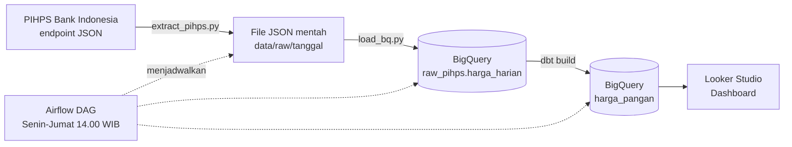

# Monitoring Harga Pangan Indonesia

Pipeline data otomatis yang menarik harga pangan harian dari **PIHPS Nasional (Bank Indonesia)**, menyimpannya di **BigQuery**, mengolah dan mengetesnya dengan **dbt**, menjadwalkannya dengan **Airflow**, lalu menampilkannya di dashboard **Looker Studio**.

Project ini menjawab tiga pertanyaan bisnis:

1. **Disparitas**: provinsi mana yang harganya paling jauh di atas atau di bawah rata-rata nasional?
2. **Volatilitas**: komoditas mana yang harganya paling bergejolak?
3. **Margin rantai pasok**: di tahap mana kenaikan harga terbesar terjadi, dari produsen ke pedagang besar atau dari pedagang besar ke pasar?

**📊 Dashboard:** [Monitoring Harga Pangan Indonesia](https://datastudio.google.com/reporting/34b5a572-24f8-4907-8b99-fba8fae5d65f)

---

## Cakupan Data

| Dimensi | Cakupan |
|---|---|
| Komoditas | 21 komoditas dalam 10 kategori (beras, daging ayam, daging sapi, telur, bawang merah, bawang putih, cabai merah, cabai rawit, minyak goreng, gula pasir) |
| Jenis pasar | Pasar tradisional, pasar modern, pedagang besar, produsen |
| Wilayah | 34 provinsi + rata-rata nasional |
| Periode | Januari 2026 sampai sekarang, diperbarui setiap hari kerja |
| Ukuran | ±500 ribu baris harga harian yang sudah dibersihkan |

---

## Arsitektur



**Alur harian (DAG `harga_pangan_daily`):**

1. **`extract_pihps`**: menarik harga 7 hari terakhir untuk 21 komoditas × 4 jenis pasar (84 request), disimpan apa adanya sebagai JSON.
2. **`load_bigquery`**: mengubah data dari bentuk *wide* (tanggal sebagai kolom) menjadi *long*, lalu memuatnya ke tabel mentah dengan `WRITE_APPEND`.
3. **`dbt_build`**: membangun ulang semua model dan menjalankan tes kualitas data. Kalau tes gagal, tabel dashboard tidak diperbarui.

Tarikan 7 hari yang tumpang tindih sengaja dipakai supaya data yang telat diisi atau direvisi di sumber tetap tertangkap. Duplikatnya dibuang di dbt dengan mengambil versi muatan terbaru.

---

## Tools

| Tools | Peran |
|---|---|
| **Python** (`requests`) | Menarik data dari endpoint PIHPS, backfill histori per bulan |
| **BigQuery** | Data warehouse untuk data mentah dan hasil olahan |
| **dbt** | Transformasi SQL berlapis (staging → marts), seed referensi, dan tes kualitas data |
| **Airflow** (Docker) | Penjadwalan dan orkestrasi pipeline harian |
| **Looker Studio** | Dashboard interaktif 4 halaman |
| **Git & GitHub** | Version control seluruh kode |

---

## Temuan Utama

**Disparitas provinsi.** Pada September 2026, harga Beras Kualitas Medium I di pasar tradisional Kalimantan Selatan sekitar **20,7% di atas** rata-rata nasional. Kelima provinsi di Kalimantan, serta Papua dan Maluku, konsisten berada di atas rata-rata. Sebaliknya, beberapa provinsi yang dikenal sebagai daerah penghasil beras, seperti Nusa Tenggara Barat, Sulawesi Selatan, dan Jawa Timur, berada di bawah rata-rata. Sumatera Barat menjadi anomali yang menarik: harganya tinggi meskipun tidak berada di wilayah terpencil.

**Volatilitas.** Empat komoditas paling bergejolak adalah jenis cabai. Rata-rata koefisien variasi bulanan Cabai Rawit Merah (Januari sampai September 2026) sekitar **47 kali** beras. Dalam bulan terparahnya, harga Cabai Merah Keriting sempat naik hampir **50%** dari titik terendahnya. Beras dan gula menjadi komoditas paling stabil.

**Margin rantai pasok.** Untuk beras, kenaikan harga terbesar terjadi dari produsen ke pedagang besar (sekitar 11 sampai 15%), sedangkan dari pedagang besar ke pasar hanya sekitar 3 sampai 7%. Telur menunjukkan pola sebaliknya: hampir tidak ada kenaikan di tahap pedagang besar (sekitar 1%), tetapi naik sekitar 12% di tahap eceran.

**Pola musiman.** Harga daging sapi di pasar tradisional menunjukkan lonjakan sekitar pertengahan Maret dan akhir Mei 2026, berdekatan dengan Idulfitri dan Iduladha.

> Penjelasan sebab dari pola di atas (biaya distribusi, preferensi varietas, kebijakan stok, permintaan musiman) masih berupa hipotesis dan perlu dikonfirmasi dengan sumber lain. Data hanya menunjukkan polanya.

---

## Model dbt

```
raw_pihps.harga_harian (source, diisi Python)
        │
        ▼
stg_pihps__harga_harian (view)
  - tanggal teks "05/10/2026" → DATE
  - harga teks "14,900" → INT64, tanda "-" → NULL lalu dibuang
  - duplikat antar tarikan dibuang (ambil loaded_at terbaru)
        │
        ▼        seeds: komoditas.csv, jenis_pasar.csv
fct_harga_harian (table) ◄────────────┘
        │
        ├──► mart_disparitas_provinsi    (selisih % provinsi vs nasional, per bulan)
        ├──► mart_volatilitas_komoditas  (koefisien variasi dan rentang harga, per bulan)
        └──► mart_margin_rantai_pasok    (harga per jenis pasar dan margin antar tahap, per bulan)
```

**Tes kualitas data (8 tes):**

- `not_null` pada kolom kunci: jenis pasar, komoditas, wilayah, tanggal, harga
- `relationships`: setiap kode komoditas dan jenis pasar harus terdaftar di seed. Tes ini otomatis gagal kalau PIHPS menambah komoditas baru.
- Singular test `assert_stg_harga_tidak_duplikat`: satu kombinasi jenis pasar × komoditas × wilayah × tanggal hanya boleh punya satu baris

Konversi harga sengaja memakai `CAST` biasa (bukan `SAFE_CAST`) setelah tanda `-` ditangani secara eksplisit, supaya nilai aneh yang belum dikenal membuat pipeline berhenti dengan pesan jelas, bukan diam-diam menjadi NULL.

---

## Struktur Repo

```
harga_pangan_pipeline/
├── extract/
│   ├── extract_pihps.py       # tarikan harian (7 hari terakhir)
│   ├── backfill_pihps.py      # tarikan histori per bulan, bisa dilanjutkan
│   ├── load_bq.py             # wide → long, muat ke BigQuery
│   └── tes_koneksi_bq.py      # cek koneksi ke BigQuery
├── dbt_harga_pangan/
│   ├── models/staging/        # source, model staging, dan tesnya
│   ├── models/marts/          # fct_harga_harian dan 3 model analisis
│   ├── seeds/                 # komoditas.csv, jenis_pasar.csv
│   └── tests/                 # singular test duplikat
├── dags/
│   └── harga_pangan_daily.py  # DAG Airflow
├── dbt_profiles/
│   └── profiles.yml           # profil dbt untuk di dalam container
├── Dockerfile                 # Airflow 3.2 + dbt-bigquery di venv terpisah
├── docker-compose.yml
└── requirements.txt
```

---

## Cara Menjalankan

**Prasyarat:** Python 3.12+, Docker Desktop, project Google Cloud dengan BigQuery, dan service account dengan role **BigQuery Data Editor** dan **BigQuery Job User**. Simpan file kunci JSON-nya di `credentials/bq-key.json` (folder ini diabaikan Git).

**1. Manual (tanpa Airflow)**

```bash
python -m venv .venv
.venv\Scripts\activate          # Windows
pip install -r requirements.txt

python extract/extract_pihps.py
python extract/load_bq.py

cd dbt_harga_pangan
dbt build
```

**2. Backfill histori**

```bash
python extract/backfill_pihps.py
python extract/load_bq.py data/raw/backfill/2026-01   # ulangi untuk setiap bulan
```

**3. Dengan Airflow (Docker)**

```bash
docker compose build
docker compose up -d
```

Buka `http://localhost:8080`, aktifkan DAG `harga_pangan_daily`, lalu jalankan dengan tombol **Trigger**. Untuk mematikan: `docker compose stop`. Untuk menyalakan lagi: `docker compose start`.

**4. Memulihkan tabel mentah (BigQuery Sandbox)**

Di mode sandbox, tabel otomatis terhapus 60 hari setelah dibuat. Script ini menghapus tabel mentah lalu memuat ulang semua file JSON dari folder `data/`, sehingga tabel mendapat masa hidup 60 hari yang baru. Jalankan setiap ±50 hari, lalu bangun ulang model dbt:

```bash
python extract/rebuild_raw.py
cd dbt_harga_pangan
dbt build
```

---

## Keterbatasan

- **Endpoint tidak resmi.** PIHPS tidak menyediakan dokumentasi API publik. Endpoint ditemukan lewat tab Network di browser, sehingga bisa berubah sewaktu-waktu. Script sudah dilengkapi penanganan error dan jeda antar request.
- **Hanya hari kerja.** PIHPS tidak mencatat harga di akhir pekan dan hari libur.
- **34 provinsi.** Provinsi hasil pemekaran Papua belum tercatat terpisah.
- **Data produsen terbatas.** Harga produsen beberapa komoditas hanya tersedia di sedikit provinsi. Contohnya bawang putih, yang sebagian besar pasokannya berasal dari impor, sehingga margin bawang putih tidak mencerminkan keuntungan pedagang.
- **Rata-rata nasional antar tahap bisa berasal dari kumpulan provinsi yang berbeda**, sehingga angka margin adalah gambaran umum, bukan pengukuran satu rantai distribusi yang sama.
- **Airflow berjalan di laptop**, sehingga jadwal hanya jalan saat container menyala. Berkat tarikan 7 hari terakhir, menjalankannya seminggu sekali tetap menghasilkan data yang lengkap. Untuk produksi, pipeline ini bisa dipindahkan ke server cloud.
- **BigQuery Sandbox** memiliki batas waktu kedaluwarsa tabel. Kalau tabel mentah terhapus, histori bisa dipulihkan dengan `backfill_pihps.py`.
- **BigQuery Sandbox** menghapus tabel 60 hari setelah dibuat. Semua data mentah tetap tersimpan sebagai JSON di laptop, sehingga tabel bisa dibangun ulang kapan saja dengan `rebuild_raw.py` tanpa menarik ulang dari PIHPS.
---

## Sumber Data

Pusat Informasi Harga Pangan Strategis (PIHPS) Nasional, Bank Indonesia: [bi.go.id/hargapangan](https://www.bi.go.id/hargapangan)

Project ini dibuat untuk portofolio dan tidak berafiliasi dengan Bank Indonesia.
